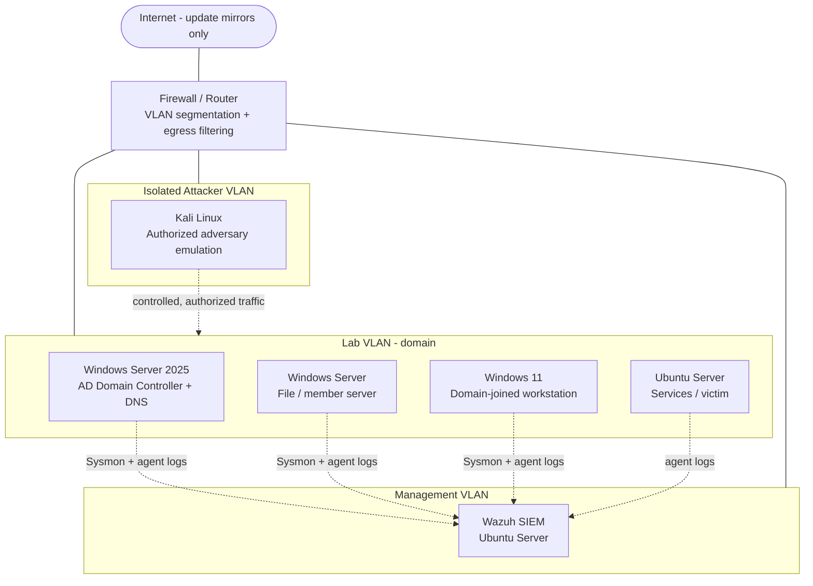

# Network Diagram

The lab runs on a hypervisor (VMware / Proxmox) with the lab network isolated from my home network and the internet restricted to update mirrors only. Addresses below are intentionally generic — no real IPs are published.

## Topology



## Segmentation rationale
- **Management VLAN** isolates the SIEM so that collection/alerting keeps working even when the lab VLAN is intentionally compromised during an exercise.
- **Lab VLAN** holds the Active Directory domain and the systems under test.
- **Attacker VLAN** is firewalled so adversary emulation only reaches the lab on purpose, and never my real network.
- Egress is restricted to OS/software update sources so nothing in the lab reaches the public internet uncontrolled.

## ASCII fallback
```
[ Internet (updates only) ]
            |
      [ Firewall ] --- VLAN segmentation + egress filtering
       /    |    \
 [MGMT]  [LAB]   [ATTACKER]
   |       |         |
 Wazuh   DC/FS/WS/Linux   Kali (isolated)
   ^       |
   |_______|  endpoint telemetry (Sysmon + agents) -> Wazuh
```
